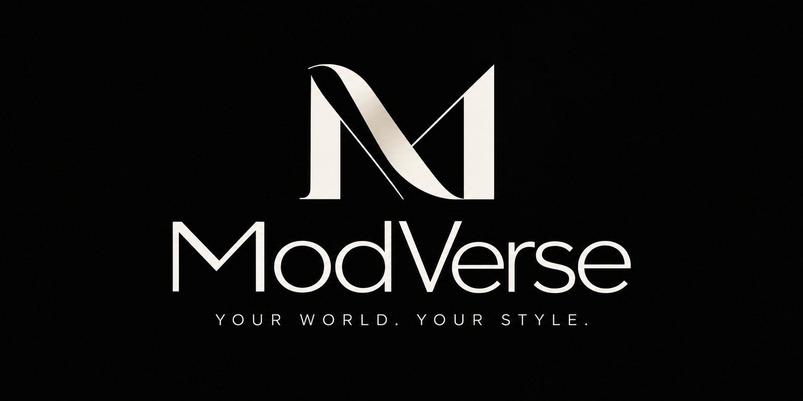

<p align="center"></p>

# ModVerse

**AI-powered personalised fashion design and commerce platform — YOUR WORLD. YOUR STYLE.**

ModVerse lets customers design the *garment itself* — silhouette, construction, proportions, fabric, every panel, typography and artwork — guided by **AI Muse** (an AI Fashion Director whose proposals are compiled, validated and applied as one undoable step), previewed in realistic parametric **3D**, tried on with a **live camera**, checked by a **manufacturing rules engine**, priced from real manufacturing cost drivers, ordered through a full commerce flow and fulfilled by approved **manufacturer and logistics partners**. Initial market: India. Initial catalogue: Men's, Women's and Kids' T-shirts (15 models) and shirts (17 models).

Everything runs **locally with no paid services or credentials**. External providers (OpenAI, Meta Muse, Ollama, ComfyUI, Razorpay, Shiprocket, Resend, Google sign-in, …) are prepared behind an admin **Integration Manager** and stay inactive until tested and enabled.

## Quick start (macOS / Linux, Node ≥ 20.9)

```bash
npm install
npm run setup     # imports the Creative Library, syncs fonts, migrates + seeds the DB, fetches CV models
npm run build && npm start      # http://localhost:3000   (or: npm run dev)
```

* The database is **embedded PostgreSQL (PGlite)** stored in `.data/` — no install required. Set `DATABASE_URL` to use any PostgreSQL server instead (verified on PostgreSQL 16).
* On first start, an admin, a staff and a demo customer account are created with **random passwords written to `.data/ADMIN_CREDENTIALS.txt`** (git-ignored). Set `ADMIN_EMAIL` / `ADMIN_PASSWORD` to choose your own.
* **The Muse image studio** (`/design/muse`): FLUX.1 [schnell], SDXL, Qwen-Image and FLUX.2 [klein] 4B on your own ComfyUI GPU server — setup in `docs/MUSE_IMAGE_STUDIO.md` (needs a GPU server; not usable without one).
* **Human Studio** (Atelier Pro, `/design/human-studio`): a fitting mannequin for men and women shaped to tape measurements, trying 3D collection garments on by size with a fit map. See `docs/HUMAN_STUDIO.md`.
* `npm run models:fetch` downloads the MediaPipe pose/segmentation models for the trial room; without them it falls back to the public MediaPipe CDN.
* Copy `.env.example` to `.env.local` only if you need to override defaults. **Never commit `.env*` or `.data/`.**

## What's inside

| Area | Highlights |
|---|---|
| Brand | Official logo stored byte-for-byte; responsive treatments are crops / alpha-masks of the original (`scripts/derive-brand-assets.py`). |
| Catalogue | Men / Women, 32 distinct parametric models, 19 fabrics, Indian size charts, flats generated from real geometry. |
| Design experiences | **Design Studio** (guided), **Atelier** (advanced), **Atelier Pro** (professional) — one engine, three workflows. |
| Garment engine | Fit, proportions, neckline/collar, placket, sleeves/cuffs, hem, pockets, yoke, pleats, darts, buttons, stitching, monogram, 11 independent panels. |
| Typography | 34 OFL fonts (incl. Devanagari, Tamil, Bengali), curved/circular/vertical text, outline, shadow, background, skew; identical in 2D, 3D and print. |
| Creative Library | The supplied v0.1 library (1,000 assets, 20 collections) **plus the ModVerse Studio Library** — ~970 original assets in 24 collections (festive & desi, mandala/rangoli, wildlife, pets, playful characters, sports, music, gaming, food, travel, wellness, botanical, surf, retro, celestial, streetwear, celebration, campus, eco, abstract, line art, stickers, badges, seamless patterns). Every graphic is recolourable (≤5 colours) and one-tap palette-swappable; place on any 2D/3D surface. |
| AI Muse | Local deterministic text-to-design + conversational editing that applies validated operations; optional Ollama/OpenAI. AI artwork generation through ComfyUI, **Meta Muse Image** or OpenAI — all inactive until an admin adds a key, passes the connection test and enables it (Meta's generation endpoint additionally needs billing set up on the Meta team). |
| 3D | React Three Fiber parametric garments (lofted sleeves, collars, plackets, buttons, pockets, cuffs), fabric relief, fitted on the **Human Studio mannequin** (CC0 MakeHuman body shaped to measurements, size fit map, cloth simulation). |
| Trial room | MediaPipe on-device pose tracking — Level A (2D), B (3D on landmarks), C (experimental occlusion). |
| Manufacturing | Validation engine with fixes, tech pack PDF/JSON, BOM, measurement sheet, print-ready SVG / 300 DPI PNG, CAD exchange JSON. |
| Commerce | Cart, checkout, order snapshots, simulated payments (labelled) or Razorpay test mode with signature verification, order tracking. |
| Accounts | **Guest mode** (one-click account with every signed-in feature, savable later), Argon2id auth, sessions, password reset & email verification (simulated mailbox), measurements and avatars. |
| Admin | Analytics, orders + production approval, design reviews, production board, shipping, disputes, partner approval, pricing & discounts, users/roles, catalogue, library, Integration Manager, audit log, settings. |
| **V2: AI pipeline** | Fashion Director (local rules, or Ollama / Gemini / OpenAI / on-device Gemini Nano when enabled) → artwork resolution → design compiler (validated, previewed, priced) → applied as one undoable transaction. |
| **V2: fit & try-on** | Live trial room that doubles as a **fit check** — every size compared zone by zone with your measurements against the garment's design intent, best size, and a fit map on your live image; fit analysis keeps *estimated*, *simulated* and customer-*verified* fit separate. |
| **Light mode** | White UI theme across the whole site (toggle or Dark/Light/System in settings). |
| **V2: dynamic pricing** | Itemised, manufacturing-aware prices (fabric consumption from real panel areas, colours, stitches, placements), admin rules and discount codes, server-verified totals and price snapshots. |
| **V2: partner portals** | Manufacturers (jobs, quotations, stages, QC, photos, production tech pack) and logistics partners (labels, pickups, tracking, proof of delivery), admin approval, disputes, notifications, a payouts ledger and optional Shiprocket courier booking — each organisation sees only its own work. |

## Scripts

| Command | Purpose |
|---|---|
| `npm run dev` / `build` / `start` | Next.js development / production |
| `npm run lint` · `typecheck` · `test` · `test:e2e` | Quality gates (see [docs/TESTING.md](docs/TESTING.md)) |
| `npm run db:migrate` · `db:seed` · `db:reset` | Database lifecycle (`db:generate` creates new migrations) |
| `npm run library:import` | Re-import the Creative Library from `assets/` |
| `npm run graphics:import` | Re-import the openly licensed graphics and their registry (see docs/GRAPHICS_LIBRARY.md) |
| `python3 -I scripts/human/build_human.py <mpfb.zip> .` | Rebuild the Human Studio body and the garment fitting data from the CC0 MakeHuman / MPFB data (needs numpy; see docs/HUMAN_STUDIO.md) |
| `npm run fonts:sync` · `models:fetch` · `brand:derive` | Fonts, CV models, logo variants |
| `npm run ai:eval` · `perf` | AI pipeline evaluation · performance probe against a running build |

## Documentation

[Build status](docs/BUILD_STATUS.md) · [Architecture](docs/ARCHITECTURE.md) · [Database](docs/DATABASE_SCHEMA.md) · [Brand](docs/BRAND_GUIDELINES.md) · [Garment system](docs/GARMENT_SYSTEM.md) · [2D editor](docs/2D_EDITOR.md) · [3D system](docs/3D_SYSTEM.md) · [AI system](docs/AI_SYSTEM.md) · [Typography](docs/TYPOGRAPHY_SYSTEM.md) · [Virtual try-on](docs/VIRTUAL_TRY_ON.md) · [Live try-on](docs/LIVE_TRY_ON.md) · [Dynamic pricing](docs/DYNAMIC_PRICING.md) · [Manufacturing](docs/MANUFACTURING.md) · [Partner portals](docs/PARTNER_PORTALS.md) · [Creative Library](docs/CREATIVE_LIBRARY.md) · [Security](docs/SECURITY.md) · [Integrations](docs/INTEGRATIONS.md) · [API setup](docs/API_SETUP_GUIDE.md) · [Costs](docs/COST_AND_DEPENDENCIES.md) · [Provider status](docs/PROVIDER_STATUS.md) · [Quality & provider evaluation](docs/QUALITY_AND_PROVIDER_EVALUATION.md) · [Testing](docs/TESTING.md) · [Performance](docs/PERFORMANCE.md) · [Master specification](docs/MASTER_PROMPT.md)

## Honesty notes

Size recommendations are estimates; avatars are visual representations (the garment on the rigged characters is skinned to the skeleton, not cloth-simulated); 3D garments are parametric visualisations; the trial room is pose-tracked overlay, not physically accurate clothing; tech packs are **design-intent documents, not factory-ready patterns**; payments are simulated unless a provider is configured; manufacturers and logistics companies work through the partner portals, but courier bookings (AWB, labels) are ModVerse-issued until a courier API is connected; prices are illustrative until supplier rates are verified. See [/about/honesty](src/app/(site)/about/honesty/page.tsx).
