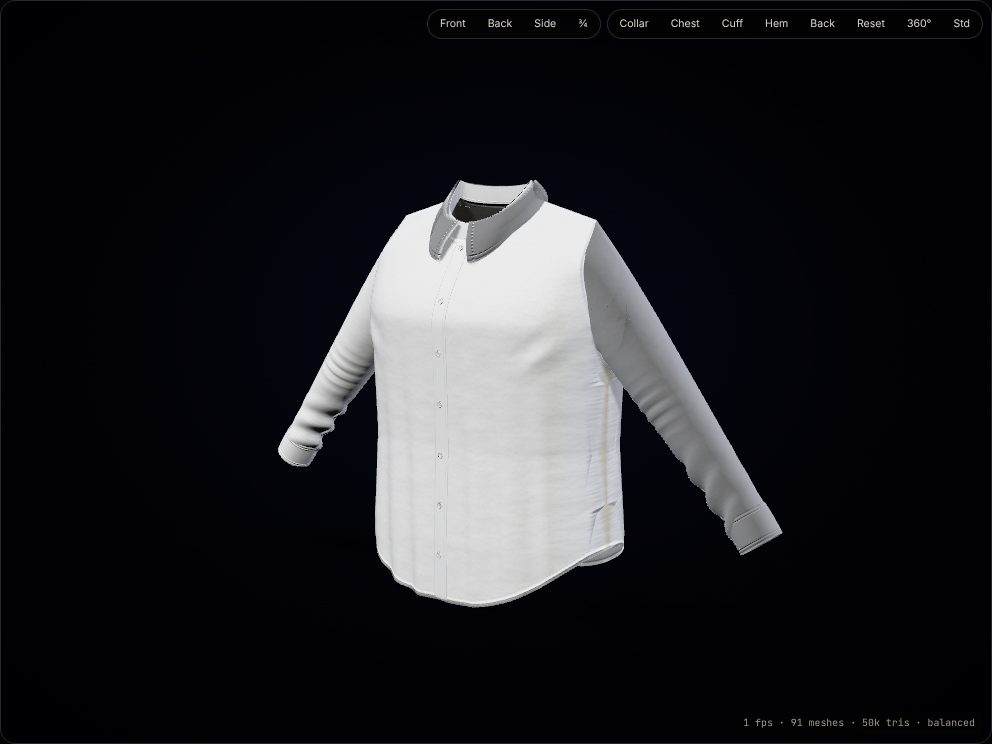
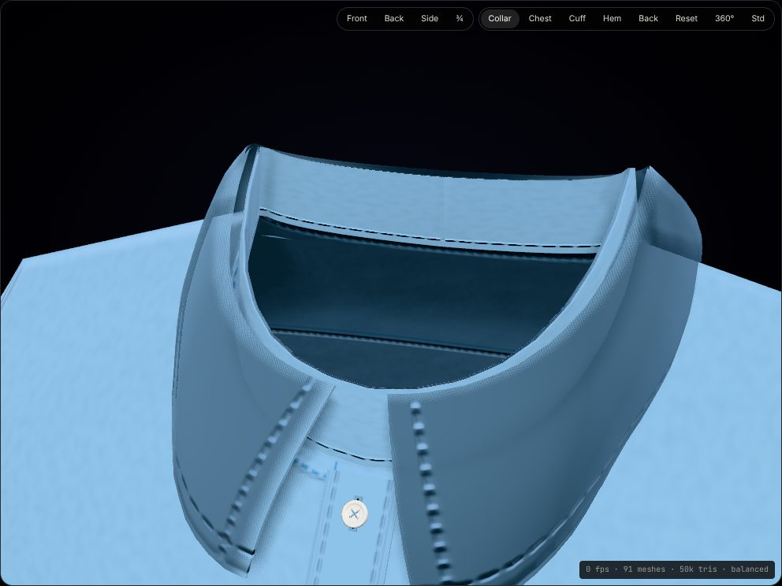
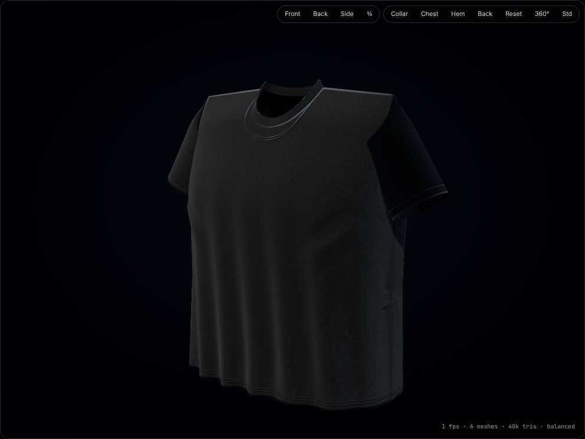
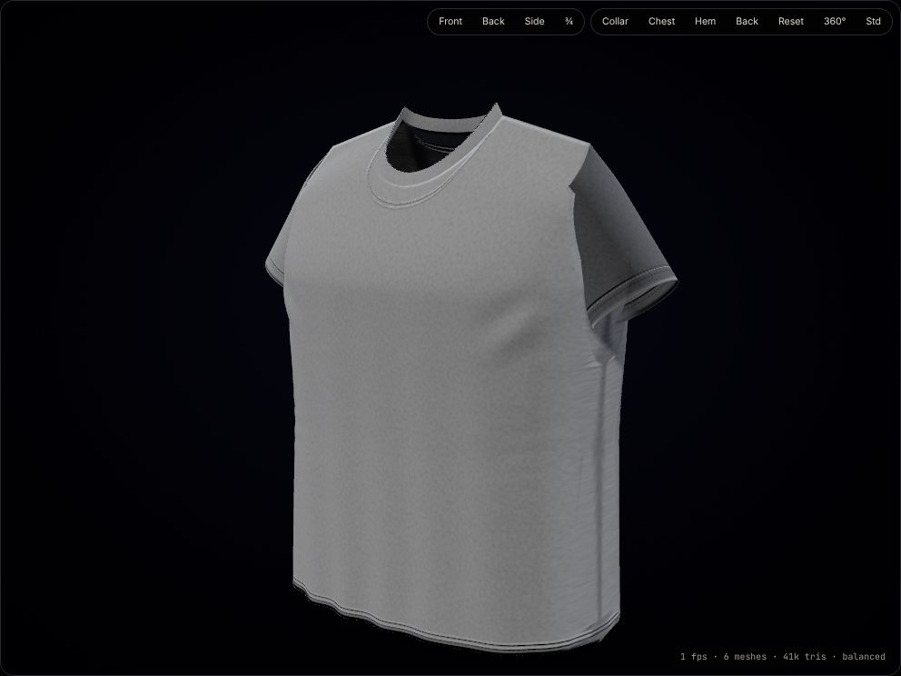
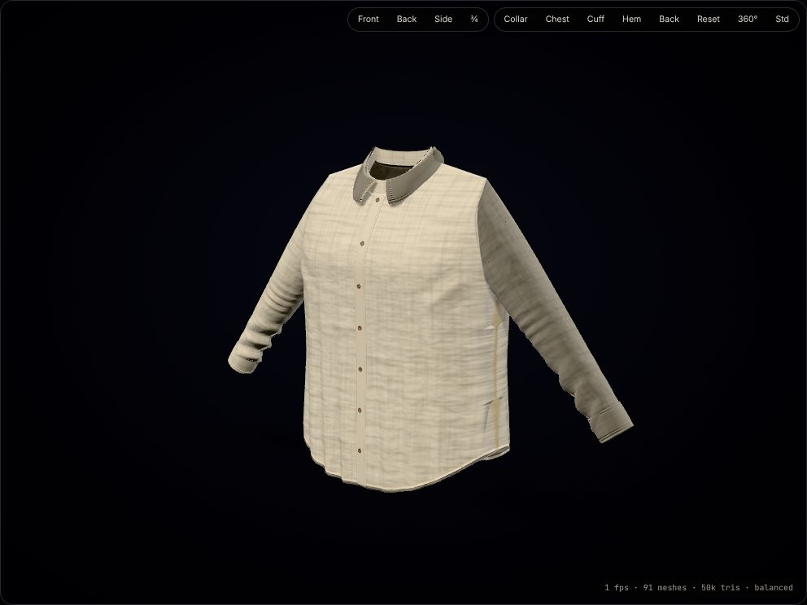

# Quality & provider evaluation

Status labels: **Fully implemented** · **Locally implemented** · **Simulated** · **Awaiting credentials** · **Partially implemented** · **Not implemented**.

## 1. 3D garment quality benchmarks
Quality-first strategy: three benchmark garments (plus a linen shirt for fabric contrast), rendered in the 3D quality lab (`/lab/3d`) with the production viewer (Std quality: GTAO, relief normal maps, PBR fabric maps).

| Benchmark | What to look for | Image |
|---|---|---|
| Classic formal shirt (white poplin) | collar stand + thick leaves with topstitching, layered placket with buttonholes and four-hole buttons, barrel cuffs with cuff buttons, curved hem, soft folds; white keeps its contours on the dark backdrop |  |
| Classic formal shirt — collar inspection (sky blue) | detail-inspection camera; collar thickness, stitch rows, buttonhole, cross-stitched button |  |
| Oversized T-shirt (black jersey) | drop shoulders, boxy silhouette, wavy hem drape, rib neckband with double-needle stitch, readable form on black |  |
| Regular-fit T-shirt (heather grey) | rib neckband, double-needle hems, closed side seams, jersey heather texture |  |
| Linen shirt (natural) | linen slubs, higher crease density, different roughness — fabric changes appearance, not just colour |  |

**Status:** parametric geometry, fabric PBR materials, procedural folds, lighting/AO and viewer — **Fully implemented** for all 32 models (the benchmarks set the bar). Cloth simulation — **Not implemented** (folds are a labelled procedural approximation). Blender/CLO 3D asset pipeline — **Not implemented** (no licences or source assets; GLB *export* is implemented).

**Performance.** The lab shows FPS, meshes and triangles (`showStats`). A garment is ~40–50 k triangles and 6–106 meshes (buttons/buttonholes dominate the count on shirts). Figures captured in this repository's CI run on **software rendering (SwiftShader, 0–15 fps)** and are **not representative**; measure on target hardware (desktop GPU and a mid-range Android/iPhone) with `/lab/3d?...` and the quality toggle (Fast disables AO/relief and caps DPR at 1.5; it is the default on low-power touch devices and compact viewers).

## 2. Fashion Director (AI) providers

### Measured (this repository, `npm run ai:eval`)
Suite: 12 prompts / 26 expectations — V2 spec example, V1 linen shirt, colour edits, collar + pocket, name on back with font, embroidered monogram, length +5 cm, kids yellow tee with graphic, 240 GSM, unsupported zipper, bigger text, colour change preserving existing text.

| Provider | Schema-valid | Compiled | Expectations met | Avg ops | Rejected items | Latency p50 / p95 |
|---|---|---|---|---|---|---|
| Local rules (offline) | 100% | 92% | 100% (26/26) | 2.3 | 2 | ~2 / 31 ms |

"Compiled" < 100 % is expected: the zipper prompt correctly produces no operation. Ollama, Gemini and OpenAI were **not run** — no models or credentials are available in this environment and billable APIs are never called without authorisation. Run them yourself:
```bash
EVAL_OLLAMA_URL=http://127.0.0.1:11434 EVAL_OLLAMA_MODEL=llama3.1:8b npm run ai:eval
EVAL_GEMINI_KEY=… EVAL_GEMINI_MODEL=gemini-2.5-flash npm run ai:eval
EVAL_OPENAI_KEY=… EVAL_OPENAI_MODEL=gpt-4.1-mini npm run ai:eval
```

### Qualitative comparison (to be confirmed with the harness)
| Criterion | Local rules | Ollama (local LLM) | Gemini API | OpenAI API | Gemini Nano (on-device) |
|---|---|---|---|---|---|
| Status | **Fully implemented** | **Awaiting credentials** (adapter + test) | **Awaiting credentials** (adapter + test) | **Awaiting credentials** (adapter + test) | **Locally implemented, experimental** (needs a supporting Chrome) |
| Creative quality | Literal; strong on garment vocabulary, weak on open-ended briefs | Model-dependent (8B models adequate for edits, weaker for briefs) | High for briefs and styling language | High | Limited — short edits |
| Structured-output reliability | Deterministic | Good with JSON-schema `format` (Ollama ≥ 0.5); smaller models drift | Good (JSON mode); validated + fallback | Good (JSON mode); validated + fallback | Uses `responseConstraint`; small context limits long catalogues |
| Latency | < 50 ms | Hardware-bound (seconds on CPU) | ~1–5 s typical | ~1–5 s typical | Device-bound; first use downloads the model |
| Cost | Free | Free (local compute) | Free tier + paid usage | Paid usage | Free |
| Context handling | n/a | Model-dependent (4–128 k) | Large | Large | Small — compact prompt used |
| Privacy | On server, no third party | Stays on your machine/server | Prompts sent to Google | Prompts sent to OpenAI | Stays on the customer's device |
| Device compatibility | Any | Server with RAM/GPU | Any (server-side) | Any (server-side) | Chrome desktop on supported hardware only |
| Commercial terms | ModVerse code | Model licence (e.g. Llama licence) | Google API terms; review data-use on free tier | OpenAI terms | Chrome built-in AI terms |

**Recommendation:** keep local rules as the always-on fallback; add **Ollama** for private, free creative interpretation where hardware allows; use **Gemini** or **OpenAI** for the best open-ended briefs once billing and data terms are approved; offer **Gemini Nano** as an opt-in privacy feature for quick edits. Every option goes through the same compiler, so quality differences affect interpretation only — never safety.

## 3. Artwork generation
| Provider | Status | Notes |
|---|---|---|
| Creative Library retrieval | **Fully implemented** | Vector, transparent, licensed; matched by id/collection/style words |
| ComfyUI (local) | **Awaiting credentials** (adapter + test) | Free software; check model licences for apparel |
| OpenAI Images | **Awaiting credentials** (adapter + test) | Billable; generated images stored as private uploads |
When no image model is active, "generate" requests are answered from the library with an explicit "nothing was generated" note.
